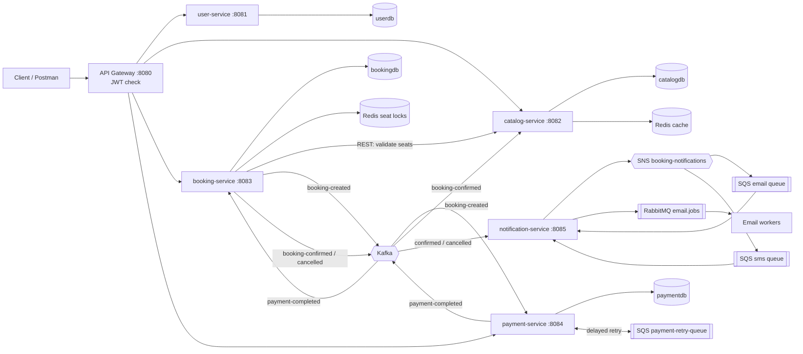

# 🎬 Ticket Booking System — Microservices with Spring Boot

A BookMyShow-style backend: users browse movies, hold seats, pay, and get notified.
Built to practise **Core Java, Spring Boot, Spring Cloud, MySQL, Redis, Kafka, RabbitMQ, AWS SQS/SNS, Docker and Kubernetes** together on one realistic problem: *two people must never get the same seat.*

---

## 1. Requirements & platform

### Software to install

| Tool | Version | Why |
|---|---|---|
| JDK | 17 or 21 | Language runtime (code targets Java 17) |
| Maven | 3.9+ | Build tool (multi-module project) |
| Docker Desktop (or Docker Engine + Compose v2) | latest | Runs MySQL, Redis, Kafka, RabbitMQ, LocalStack and the services |
| IntelliJ IDEA Community / VS Code | any | IDE; install the **Lombok** plugin and enable annotation processing |
| minikube or kind + kubectl | latest | Local Kubernetes cluster (phase 6) |
| Postman / curl + jq | any | Calling the APIs |
| Git + GitHub account | any | Version control; GitHub Copilot if you have it |

**Machine:** Windows 10/11 (with WSL2), macOS or Linux. **16 GB RAM recommended** — the full stack runs ~11 containers. With 8 GB, run only the infrastructure in Docker and start 2–3 services from the IDE at a time.

**Cost:** ₹0. AWS SQS/SNS are emulated locally by **LocalStack**, so no AWS account is needed.

### Tech stack and where each piece is used

| Technology | Where | What it does here |
|---|---|---|
| Core Java 17 | everywhere | records, streams, `Optional`, text blocks |
| Spring Boot 3.3 | all services | REST APIs, JPA, validation, actuator |
| Spring Cloud Gateway | `api-gateway` | single entry point, routing, JWT validation |
| MySQL 8 | user, catalog, booking, payment | **database per service**, indexes, unique constraints, optimistic locking (`@Version`) |
| Redis | catalog-service | `@Cacheable` movie/show/seat listings |
| Redis | booking-service | **distributed seat locks** with `SET NX` + TTL and an owner-checked Lua release |
| Kafka | booking ↔ payment ↔ catalog ↔ notification | domain events that drive the **Saga** |
| AWS SQS | payment-service | delayed **retries** after gateway timeouts, with a dead-letter queue |
| AWS SNS | notification-service | **fan-out**: one publish reaches the email and SMS queues |
| RabbitMQ | notification-service | **worker pool** for sending email, retries + DLQ |
| Docker / Compose | root | one Dockerfile for all services, whole system with one command |
| Kubernetes | `k8s/` | Deployments, Services, ConfigMap, Secret, probes, 2 booking replicas |

---

## 2. Architecture



### The booking Saga, step by step

1. **POST /api/bookings** → booking-service asks catalog-service whether the seats exist and are not booked.
2. It **locks every seat in Redis** (`SET seat-lock:{show}:{seat} {bookingRef} NX PX 300000`). All-or-nothing: if one seat is taken, the ones already locked are released and the user gets **409 Conflict**.
3. Booking saved as **PENDING** in MySQL. *After the transaction commits*, `booking-created` goes to Kafka.
4. payment-service charges a mock gateway (random success / decline / timeout so you can see every path).
   - Timeout → message on **SQS** with a 10 s delay → retried up to 3 times.
   - The `booking_ref` column is **UNIQUE**, so a redelivered Kafka event can never charge twice (**idempotency**).
5. `payment-completed` → booking-service:
   - SUCCESS → **CONFIRMED** → `booking-confirmed` → catalog marks seats **BOOKED**.
   - FAILED → **CANCELLED** → seats released in Redis (**compensating action**) → `booking-cancelled`.
6. No payment within 5 minutes → a scheduler marks the booking **EXPIRED** and frees the seats.
7. notification-service publishes once to **SNS**; SNS copies it to the email and SMS **SQS** queues; email jobs go to **RabbitMQ** workers.

---

## 3. Implementation workflow (build it in this order)

Build in phases and commit after each one. Each phase leaves you with something that runs.

| Phase | Goal | Done when |
|---|---|---|
| **0. Setup** (½ day) | Install tools, create the Maven parent + `common` module, `docker compose up mysql redis kafka rabbitmq localstack` | All containers healthy (`docker compose ps`) |
| **1. User service** (1 day) | Entity, repository, register/login, BCrypt, JWT | Login returns a token in Postman |
| **2. Catalog + Redis cache** (1 day) | Movies/shows/seats, seed data, `@Cacheable` | Second call to `/api/movies` doesn't log "Cache miss" |
| **3. Booking + seat locks** (2 days) | Redis `SET NX` locks, PENDING bookings, unit test for the lock | Two parallel requests for the same seat → one 202, one 409 |
| **4. Kafka Saga** (2 days) | Payment service, events, confirm/cancel/expire paths | Booking moves PENDING → CONFIRMED by itself |
| **5. SQS, SNS, RabbitMQ** (2 days) | Payment retries, notification fan-out, email workers | `[EMAIL]` and `[SMS]` lines appear in notification logs |
| **6. Gateway + Docker** (1 day) | JWT filter, Dockerfile, full `docker compose up --build` | `scripts/demo.sh` passes end to end |
| **7. Kubernetes** (1–2 days) | Deploy to minikube, probes, 2 booking replicas | `kubectl get pods -n ticket-booking` all Running |
| **8. Polish** (1 day) | README, diagram, Swagger screenshots, tests, AI-usage notes | Repo is ready to share with recruiters |

---

## 4. Running it

### Option A — Infrastructure in Docker, services from your IDE (best while developing)

```bash
docker compose up -d mysql redis kafka rabbitmq localstack
mvn clean install -DskipTests
# then run each *Application class from IntelliJ, or:
mvn -pl user-service spring-boot:run
mvn -pl catalog-service spring-boot:run
mvn -pl booking-service spring-boot:run
mvn -pl payment-service spring-boot:run
mvn -pl notification-service spring-boot:run
mvn -pl api-gateway spring-boot:run
```
The defaults in each `application.yml` point at `localhost`, so nothing else needs configuring.

### Option B — Everything in Docker

```bash
docker compose up --build
./scripts/demo.sh            # needs curl + jq
```

### Option C — Kubernetes (minikube)

```bash
minikube start --memory=8192 --cpus=4
./scripts/build-images.sh minikube        # builds 6 images and loads them into minikube
kubectl apply -f k8s/
kubectl get pods -n ticket-booking -w     # wait until everything is Running/Ready
minikube service api-gateway -n ticket-booking --url   # prints the gateway URL
./scripts/demo.sh <that-url>
```

### Useful URLs (Option A/B)

| What | URL |
|---|---|
| API gateway | http://localhost:8080 |
| Swagger UI per service | http://localhost:8081/swagger-ui.html (8082, 8083, 8084 too) |
| RabbitMQ console | http://localhost:15672 (guest / guest) |
| Redis seat locks | `docker compose exec redis redis-cli KEYS 'seat-lock:*'` |
| Kafka messages | `docker compose exec kafka /opt/kafka/bin/kafka-console-consumer.sh --bootstrap-server localhost:9092 --topic booking-created --from-beginning` |
| SQS queues | `docker compose exec localstack awslocal sqs list-queues` |

---

## 5. API reference (through the gateway)

| Method | Path | Auth | Description |
|---|---|---|---|
| POST | `/api/auth/register` | – | `{name, email, password, phone?}` → `{token, ...}` |
| POST | `/api/auth/login` | – | `{email, password}` → `{token, ...}` |
| GET | `/api/users/me` | JWT | Current user's profile |
| GET | `/api/movies` | – | All movies (cached) |
| GET | `/api/movies/{id}/shows` | – | Shows for a movie (cached) |
| GET | `/api/shows/{id}/seats` | – | Seat map with price |
| POST | `/api/bookings` | JWT | `{showId, seatNumbers:["A1","A2"]}` → 202 PENDING, or 409 if held |
| GET | `/api/bookings/{bookingRef}` | JWT | Poll booking status |
| GET | `/api/bookings` | JWT | My bookings |
| GET | `/api/payments` | JWT | My payments with attempt counts |

---

## 6. Project structure

```
ticket-booking-system/
├── pom.xml                  parent: versions for Spring Boot, Spring Cloud, Spring Cloud AWS
├── common/                  shared Kafka event records + topic names
├── api-gateway/             Spring Cloud Gateway + JwtAuthenticationFilter
├── user-service/            register/login, BCrypt, JWT
├── catalog-service/         movies, shows, seats, Redis cache, seed data
├── booking-service/         SeatLockService (Redis), BookingService (Saga), expiry scheduler, tests
├── payment-service/         mock gateway, idempotency, SQS retries
├── notification-service/    SNS publish, SQS channel listeners, RabbitMQ email workers
├── infra/                   MySQL init SQL, LocalStack init script
├── k8s/                     namespace, config/secret, infra, app deployments
├── scripts/                 build-images.sh, demo.sh
├── Dockerfile               one multi-stage Dockerfile for every service
└── docker-compose.yml
```

---

## 7. Interview talking points

- **Concurrency:** Why Redis `SET NX` instead of a DB lock? (Works across many service replicas, no long-held DB row locks, TTL frees abandoned seats.) Why sort seats before locking? Why does release use a Lua script? (Don't delete a lock someone else now owns.)
- **Saga vs 2PC:** Services own separate databases, so there's no distributed transaction. Each step has a compensating action (cancel → release seats).
- **Exactly-once is a myth:** Kafka is at-least-once, so every consumer is idempotent (unique `booking_ref`, "only update PENDING").
- **Dual-write problem:** events are sent *after commit* (`@TransactionalEventListener`). Next step: the **Transactional Outbox** pattern.
- **Why three messaging systems?** Kafka = event log between services; SQS = delayed retries + DLQ without blocking a Kafka partition; SNS = fan-out to channels; RabbitMQ = work queue with competing consumers.
- **Database design:** database per service, indexes on lookup columns, unique constraints, `@Version` optimistic locking, money as `DECIMAL(10,2)`/`BigDecimal`.
- **Kubernetes:** startup/readiness/liveness probes, ConfigMap vs Secret, resource limits, `MaxRAMPercentage`.

---

## 8. Using GitHub Copilot / Claude (job requirement)

Keep a short log as you build and paste it here. Examples of honest, useful usage:

- Generated the first draft of `SeatLockServiceTest`, then added the rollback case myself.
- Asked the assistant to review `BookingService` for race conditions; it pointed out that releasing locks on success could let a second user grab a seat before catalog marked it BOOKED.
- Used Copilot to write Kubernetes probe boilerplate and the LocalStack init script.
- Always reviewed, ran and tested generated code before committing.

---

## 9. Ideas to extend it

- Flyway migrations instead of `ddl-auto=update`
- Transactional Outbox + Debezium
- Resilience4j circuit breaker on the catalog call
- Redis rate limiting in the gateway (`RequestRateLimiter`)
- Testcontainers integration tests (MySQL, Redis, Kafka)
- Swap MySQL for **MS SQL Server** in one service (change driver + URL only) to show both
- Prometheus + Grafana dashboards, distributed tracing with Micrometer + Zipkin
- GitHub Actions CI: build, test, push images
- Deploy to AWS EKS with real SQS/SNS (remove `spring.cloud.aws.endpoint`, use IAM roles)

---

### Notes
- **LocalStack:** the compose file pins `localstack/localstack:3.8`. Newer LocalStack images may ask for a free auth token (`LOCALSTACK_AUTH_TOKEN`); if the pinned tag ever fails to start, sign up at localstack.cloud and add the token as an environment variable.
- Secrets in this repo (`ticket123`, the JWT secret) are for local development only.
